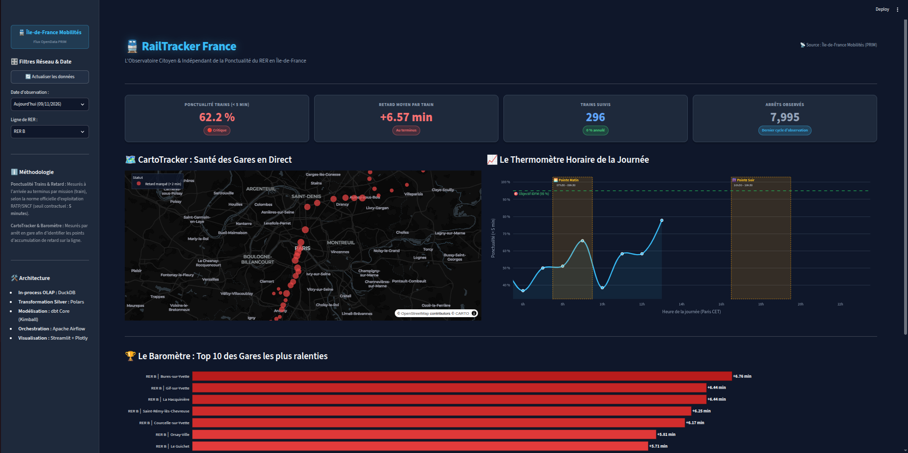
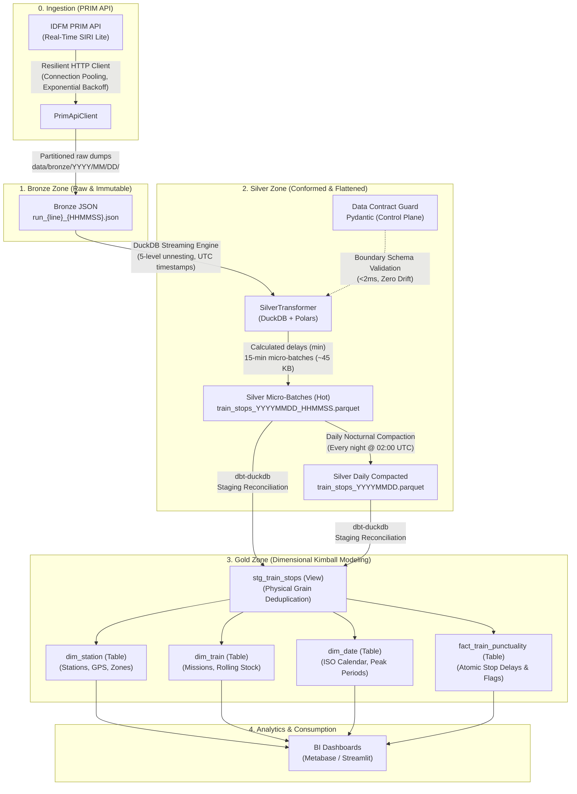

# 🚆 RailTrack — Real-Time Transit Lakehouse & Analytics Platform

[](https://github.com/loic-xu/rail-track/actions/workflows/ci.yml)
[](https://www.python.org/)
[](https://duckdb.org/)
[](https://www.getdbt.com/)
[](https://airflow.apache.org/)
[](https://www.docker.com/)
[](https://github.com/astral-sh/ruff)
[](http://mypy-lang.org/)
[](https://github.com/astral-sh/uv)

> **An end-to-end data platform tracking and modeling real-time transit punctuality on Paris commuter rail (RER A & RER B — 2.5M daily passengers) using DuckDB, dbt, and Apache Airflow.**

<p align="center">
  
</p>

---

## 📖 Executive Summary & Business Context

**RER A and RER B** are among the most heavily trafficked commuter rail corridors in Europe, moving more than **2.5 million passengers every day**. While regional authorities (Île-de-France Mobilités - IDFM) and operators (SNCF, RATP) publish aggregated monthly reliability reports, commuters and transit planners lack transparent, stop-by-stop metrics on:

1. **Atomic Station Delays:** Calculating precise scheduled vs. expected deltas at every single platform stop.
2. **Delay Cascading Dynamics ("Snowball Effect"):** Pinpointing the bottleneck stations where micro-delays accumulate and amplify along the corridor.
3. **Partial vs. Full Cancellations:** Tracking ghost trains, skipped stations, and shortened missions.
4. **Contractual Punctuality Compliance:** Measuring real-time adherence against the official IDFM 5-minute contract threshold.

**RailTrack** addresses this by ingesting real-time telemetry from the **PRIM API** (Plateforme Régionale d'Information pour la Mobilité) and transforming highly nested, sparse JSON payloads into an optimized dimensional star schema powered by **DuckDB**, **dbt**, and **Apache Airflow**.

---

## 🏗️ Architecture: The Medallion Lakehouse

The data platform applies the **Medallion Pattern (Bronze ➔ Silver ➔ Gold)** to guarantee end-to-end immutability, zero-loss backfills, and sub-second analytical queries.



---

## 📊 Gold Layer: Kimball Dimensional Star Schema

The Gold layer models train punctuality as an atomic fact table surrounded by conforming dimensions:

```mermaid
erDiagram
    fact_train_punctuality }|..|| dim_station : "dessert (station_key)"
    fact_train_punctuality }|..|| dim_train : "assure par (train_key)"
    fact_train_punctuality }|..|| dim_date : "a lieu le (date_key)"

    fact_train_punctuality {
        string punctuality_key PK "MD5(journey_id || stop_point_ref)"
        string train_key FK "MD5(journey_id)"
        string station_key FK "MD5(stop_point_ref)"
        int date_key FK "Date integer (YYYYMMDD)"
        string journey_id "Vehicle Journey ID"
        string stop_point_ref "STIF Stop Area ID"
        int stop_sequence "Canonical stop order (1..N)"
        string platform "Assigned platform"
        timestamp aimed_arrival_time "Scheduled arrival (UTC)"
        timestamp expected_arrival_time "Real-time arrival (UTC)"
        timestamp aimed_departure_time "Scheduled departure (UTC)"
        timestamp expected_departure_time "Real-time departure (UTC)"
        float arrival_delay_min "Delay at arrival (min)"
        float departure_delay_min "Delay at departure (min)"
        string arrival_status "ON_TIME, DELAYED, EARLY"
        string departure_status "ON_TIME, DELAYED, EARLY"
        boolean is_cancelled "Mission cancellation flag"
        boolean is_late_5min "Contractual threshold (>= 5 min)"
        timestamp recorded_at "Snapshot ingestion time"
    }

    dim_station {
        string station_key PK "MD5(stop_point_ref)"
        string stop_point_ref "Technical ID"
        string station_name "Public station name"
        string lines_served "Lines connected"
        string exploitant "SNCF / RATP"
        float latitude "GPS Latitude"
        float longitude "GPS Longitude"
    }

    dim_train {
        string train_key PK "MD5(journey_id)"
        string journey_id "Technical journey reference"
        string line_ref "Line ID"
        string line_name "Public line name (A, B)"
        string mission_code "4-letter mission code (e.g. QIKI)"
        string direction "Aller / Retour"
        string vehicle_mode "RAIL"
        string origin_name "Theoretical origin"
        string destination_name "Theoretical destination"
        string train_length "longTrain / shortTrain"
    }

    dim_date {
        int date_key PK "YYYYMMDD integer"
        date full_date "ISO Date"
        int year "Calendar year"
        int month "Month number (1-12)"
        int day "Day of month (1-31)"
        int quarter "Quarter (1-4)"
        string day_name "Monday, Tuesday..."
        string month_name "January, February..."
        int day_of_week "ISO Day of week (1-7)"
        boolean is_weekend "True if Saturday/Sunday"
    }
```



---

## 🚀 Quickstart Guide

### 1. Prerequisites
* **Python 3.12+**
* [**uv**](https://github.com/astral-sh/uv) (fast Python package installer)
* **Docker & Docker Compose** (for running Airflow)
* An API key from [Île-de-France Mobilités PRIM](https://prim.iledefrance-mobilites.fr/)

### 2. Environment Setup
```bash
# Clone the repository
git clone https://github.com/loic-xu/rail-track.git
cd rail-track

# Copy environment template and set your credentials
cp .env.example .env
# Edit .env and paste your PRIM_API_KEY
```

### 3. Local Development & Quality Gate
Install all development, test, and dbt dependencies in under 2 seconds:
```bash
# Install dependencies using uv
uv sync --all-groups

# Run the complete Quality Gate
uv run ruff check src/ tests/ dags/
uv run ruff format --check src/ tests/ dags/
uv run mypy src/ tests/
uv run pytest --verbose

# Validate dbt compilation in-memory
DBT_DUCKDB_PATH=":memory:" uv run dbt compile --profiles-dir dbt --project-dir dbt
```

### 4. Running the Pipeline Locally (CLI)
Test the entire ELT workflow manually without launching Docker:
```bash
# 1. Fetch live snapshot for RER A and RER B
uv run python -c "
from rail_track.ingestion.client import PrimApiClient
client = PrimApiClient()
for line in ['STIF:Line::C01742:', 'STIF:Line::C01743:']:
    payload = client.fetch_line_data(line)
    client.save_to_bronze(payload, line)
"

# 2. Process Bronze JSON into Silver Parquet
uv run python -c "
from rail_track.silver.transformer import SilverTransformer
SilverTransformer().process_bronze_to_silver()
"

# 3. Build Gold dimensional marts & execute tests
uv run dbt seed --profiles-dir dbt --project-dir dbt
uv run dbt run --profiles-dir dbt --project-dir dbt
uv run dbt test --profiles-dir dbt --project-dir dbt
```

### 5. Running the Automated Airflow Stack (Docker)
```bash
# Start Apache Airflow orchestration stack
docker compose up -d

# Open the Airflow Web UI
# URL: http://localhost:8080 (Login: airflow / airflow)
```
The production DAG `rail_track_pipeline` will automatically trigger every 15 minutes to ingest, clean, materialize, and test live transit data.
The companion maintenance DAG `rail_track_daily_compaction` runs automatically every night at 02:00 UTC to consolidate micro-batches into daily Parquet files without write amplification.

### 6. Launching the Citizen Analytics Dashboard (Streamlit)
```bash
# Start the real-time Streamlit dashboard
uv run streamlit run app.py
```
Open [http://localhost:8501](http://localhost:8501) to interactively explore network health, bottleneck stations, and hourly punctuality curves.

---

## ⚡ Engineering Deep Dive & Architecture Trade-offs

<details>
<summary><b>1. Decoupled Control Plane vs. Data Plane (Pydantic + DuckDB)</b></summary>
<br>

* **The Problem:** Validating every single dictionary in Python using Pydantic causes severe CPU and memory bloat on heavy transit streams. Conversely, delegating parsing entirely to DuckDB risks silent corruption: missing optional fields in JSON turn into `NULL` without failing the pipeline.
* **The Architecture Solution:**
  * **Control Plane (Pydantic):** In `PrimApiClient`, the first vehicle journey of each incoming payload is validated against strict Pydantic models in `<2 ms` to immediately catch upstream *Schema Drift* (Fail-Fast).
  * **Data Plane (DuckDB + Polars):** Once certified, the full JSON payload is flattened directly into columnar Parquet using DuckDB’s C++ streaming JSON engine without creating intermediate Python objects.
</details>

<details>
<summary><b>2. Solving the "Small Files Problem" via Daily Nocturnal Compaction</b></summary>
<br>

* **The Problem:** Ingesting RER A & B every 15 minutes generates ~84 micro-files per day (~2,520 per month). In a local or cloud Lakehouse, leaving micro-files causes severe filesystem I/O tax, metadata degradation, and file descriptor exhaustion during parallel query execution. Rewriting the entire month every night would cause massive *Write Amplification*.
* **The Architecture Solution:**
  * **Hot Ingestion (Daytime):** Real-time runs append lightweight, lock-free delta files (`train_stops_{YYYYMMDD_HHMMSS}.parquet`, ~45 KB) to preserve low-latency freshness (<15 min).
  * **Daily Compaction DAG (`rail_track_daily_compaction`):** Every night at 02:00 UTC (during the RER night break), Airflow triggers a vectorized DuckDB compaction job (`compact_day()`). It consolidates the ~84 micro-batches of the concluded day into a single daily Parquet file (`train_stops_YYYYMMDD.parquet`, ~3.5 MB) compressed with ZSTD, and atomistically deletes the deltas.
  * **Zero Write Amplification & Gold Invariance:** Unlike full-month rewrites, each day is compacted strictly once (84-to-1 reduction). Dedicated unit tests (`test_compaction_preserves_gold_invariance`) formally verify that the Gold layer dimensional marts and metrics remain 100% invariant before and after compaction.
</details>

<details>
<summary><b>3. Reconciling Real-Time Streaming Truncation (Sliding Window Bug)</b></summary>
<br>

* **The Problem:** In the SIRI Lite standard (`EstimatedTimetableDelivery`), departed stations are immediately dropped from subsequent payloads. Furthermore, the API provides no native `Order` or `StopSequence` field. Computing `stop_sequence` per snapshot caused relative sequence resets (station #5 became sequence #1 halfway through the journey). Naive deduplication on `(journey_id, stop_sequence)` destroyed 51.8% of past stop records in the warehouse while dbt tests misleadingly passed on synthetic keys.
* **The Architecture Solution:** In `stg_train_stops.sql`, a two-phase CTE reconciliation pattern was implemented:
  1. **Phase 1 (Physical Grain Deduplication):** Deduplicate strictly by `PARTITION BY journey_id, stop_point_ref ORDER BY recorded_at DESC` to retain the latest, most accurate observation for each real station.
  2. **Phase 2 (Chronological Sequence Reconstruction):** Rebuild the canonical 1..N route order across all combined stations:
     ```sql
     ROW_NUMBER() OVER (
         PARTITION BY journey_id
         ORDER BY COALESCE(aimed_arrival_time, aimed_departure_time, expected_arrival_time, expected_departure_time)
     ) AS stop_sequence
     ```
  3. **Surrogate Key:** `md5(journey_id || stop_point_ref)`.
  * **Impact:** 100% data recovery (all 14,879 real stops preserved), 0 duplicates, and pristine 1..N station sequences.
</details>

<details>
<summary><b>4. Dual Quality Gate: CI vs. Production Orchestration</b></summary>
<br>

* **In CI (GitHub Actions):** Tests **Code Integrity**. Runs Ruff, strict Mypy, 31 Pytest tests, and executes `dbt compile` in RAM using an in-memory DuckDB database (`DBT_DUCKDB_PATH=":memory:"`) without requiring production data volumes.
* **In Production (Apache Airflow):** Tests **Data Integrity**. After each 15-minute Gold materialization (`dbt run`), `task_dbt_test_gold` executes all **28 dbt data quality assertion tests**. Any violation (null primary key, broken foreign key) halts downstream processing and raises an alert.
</details>

<details>
<summary><b>5. High-Concurrency DuckDB & dbt Tuning (The "Too Many Open Files" Post-Mortem)</b></summary>
<br>

* **The Incident:** As the Silver layer crossed 200 Parquet micro-partitions, the production Airflow task `task_dbt_run_gold` failed with:
  `IO Error: Cannot open file ".../train_stops_*.parquet": Too many open files`.
* **Root Cause Analysis:**
  * `stg_train_stops` is a dbt view executing `read_parquet(...)` across all partitions with an analytical window function (`QUALIFY ROW_NUMBER()`).
  * dbt was configured with `threads: 4`, executing the 4 mart models concurrently. Each thread opened all 200+ Parquet files simultaneously ($4 \times 207 = 828$ file descriptors), exceeding the default container Linux limit (`ulimit -n = 1024`).
* **The Architecture Solution:**
  * **dbt Mono-Threading (`threads: 1` in `dbt/profiles.yml`):** DuckDB is an in-process, vector-parallelized C++ database engine. Running multi-threaded dbt against DuckDB creates file lock contention and multiplies open handles needlessly. In mono-thread dbt, DuckDB uses its own internal worker threads to process each model at maximum CPU efficiency. Gold rebuild time dropped to **0.82 seconds** with 0 errors.
  * **Container Hardening (`ulimits.nofile: 65536` in `docker-compose.yml`):** Raised open file descriptor caps in Docker to safeguard production against long-term data volume scaling.
</details>

<details>
<summary><b>6. Physical Storage Idempotence (The datetime.now() Anti-Pattern)</b></summary>
<br>

* **The Problem:** In an automated pipeline, deriving filenames from system clock (`datetime.now()`) is a critical anti-pattern. If an Airflow task is retried after a 3-minute network glitch or manually cleared via the UI, a new timestamped file (e.g. `105018.parquet` and `105019.parquet`) is generated alongside the original, creating physical duplicates on disk and corrupting downstream staging glob reads.
* **The Architecture Solution:**
  * Bronze dumps (`run_{line}_{data_interval_end:%H%M%S}.json`) and Silver partitions (`train_stops_{data_interval_end:%Y%m%d_%H%M%S}.parquet`) are bound deterministically to Airflow's execution context (`data_interval_end`).
  * Replaying or retrying any execution interval cleanly overwrites the exact target file without orphan records, guaranteeing 100% physical and logical idempotence.
</details>

---

## 📁 Repository Structure

```text
rail-track/
├── .github/
│   └── workflows/
│       └── ci.yml                     # Automated CI pipeline (lint, typecheck, pytest, dbt compile)
├── dags/
│   ├── rail_track_pipeline.py         # 15-minute ELT DAG (Bronze ➔ Silver ➔ Gold ➔ dbt test)
│   ├── rail_track_daily_compaction.py # Nocturnal daily Silver compaction DAG (02:00 UTC)
│   └── rail_track_monthly_compaction.py # Monthly cold compaction DAG
├── dbt/
│   ├── dbt_project.yml                # dbt configuration with DuckDB adapter
│   ├── profiles.yml                   # Dynamic path profiles (threads: 1, supports in-memory CI)
│   ├── seeds/
│   │   └── dim_stations_rer.csv       # OpenData IDFM RER stations referential (GPS, lines)
│   └── models/
│       ├── schema.yml                 # 28 data quality assertions (unique, not_null, relations)
│       ├── staging/
│       │   └── stg_train_stops.sql    # View: 2-phase deduplication & sequence reconstruction
│       └── marts/
│           ├── dim_date.sql           # Calendar dimension table
│           ├── dim_station.sql        # Station referential dimension table
│           ├── dim_train.sql          # Train missions dimension table
│           └── fact_train_punctuality.sql # Atomic stop fact table
├── src/
│   └── rail_track/
│       ├── ingestion/
│       │   ├── client.py              # Resilient HTTP client (Keep-Alive, Tenacity backoff)
│       │   └── models.py              # Strict Pydantic contracts for Control Plane
│       ├── silver/
│       │   └── transformer.py         # DuckDB streaming JSON unnesting, delay & compaction logic
│       └── utils/
│           └── logger.py              # Structured logging
├── tests/
│   ├── test_client.py                 # Mocked HTTP ingestion & retry tests
│   ├── test_models.py                 # Pydantic schema validation & edge case tests
│   └── test_silver.py                 # DuckDB unnesting, delays, daily compaction & Gold invariance
├── docker-compose.yml                 # Production Airflow stack + DuckDB volume mount & ulimits
├── Dockerfile                         # Custom Airflow image with dbt-duckdb and dependencies
├── pyproject.toml                     # Modern uv packaging configuration
├── .env.example                       # Documented environment variables template
└── README.md                          # Platform documentation
```

---

## 📈 Engineering Benchmarks

| Milestone | Metric | Performance |
| :--- | :--- | :--- |
| **Ingestion Validation** | Pydantic Schema Guard | $< 2\text{ ms}$ per sample |
| **Silver Unnesting** | DuckDB JSON Vectorized Unnesting | $150\text{ ms}$ per $10\text{ MB}$ raw JSON |
| **Daily Compaction** | 56 micro-batch deltas consolidated into 1 daily file | $< 100\text{ ms}$ |
| **Gold Materialization** | dbt Star Schema Full Refresh (threads: 1) | $820\text{ ms}$ for 4 models + fact table |
| **dbt Test Suite** | 28 automated assertions | $700\text{ ms}$ total execution |
| **Pytest Suite** | 31 unit, integration & gold invariance tests | $< 0.8\text{ s}$ execution |
| **Cold Storage Query** | Full year columnar scan | $< 50\text{ ms}$ |

---

## 🔮 Future Roadmap & Architectural Evolutions

Key engineering enhancements identified for scaling, production hardening, and enterprise readiness:

1. **Self-Healing Compaction (Multi-Day Auto-Backfill):**
   - Evolve `rail_track_daily_compaction` from a single-day target to dynamic auto-discovery across `data/silver/`. Automatically scans, groups, and consolidates all historical uncompacted delta files (`date < today`) sequentially without requiring manual operator intervention after infrastructure downtime.
2. **Decoupled Ingestion vs. Transformation DAGs (Airflow Datasets):**
   - Split the monolithic ELT pipeline into two isolated DAGs (`rail_track_ingest_bronze` ➔ `rail_track_processing_marts`) synchronized via Airflow Datasets (*Data-Aware Scheduling*). Completely eliminates the human misclick risk on `Clear`, guaranteeing zero blast radius and absolute immutability for the raw Bronze audit trail.
3. **dbt Incremental Materialization (`is_incremental()`):**
   - Transition `fact_train_punctuality` from full rebuild ($820\text{ ms}$) to daily rolling-window incremental merges with surrogate key deduplication once historical volume exceeds 6 months (> 4.5M rows).
4. **24/7 Cloud Pipeline Deployment:**
   - Migrate containerized Airflow stack from local environment to a lightweight cloud VPS (e.g. Hetzner / DigitalOcean / AWS EC2) or managed orchestration (Astronomer / GCP Cloud Composer) for uninterrupted round-the-clock streaming.
5. **Public Production Hosting for Streamlit Dashboard:**
   - Deploy interactive analytics UI publicly (e.g. Streamlit Community Cloud or Cloud Run container) with real-time DuckDB read-only query access for commuters and public transit stakeholders.
6. **Proactive Observability & Webhook Alerting:**
   - Integrate Airflow failure callbacks (`on_failure_callback`) dispatching structured Slack / Discord / Teams webhooks upon upstream PRIM API degradation or Pydantic contract violations.

---

## 📜 License

This project is licensed under the MIT License — see the [LICENSE](LICENSE) file for details.
Transit data is provided under the open data terms of [Île-de-France Mobilités (PRIM)](https://prim.iledefrance-mobilites.fr/).
